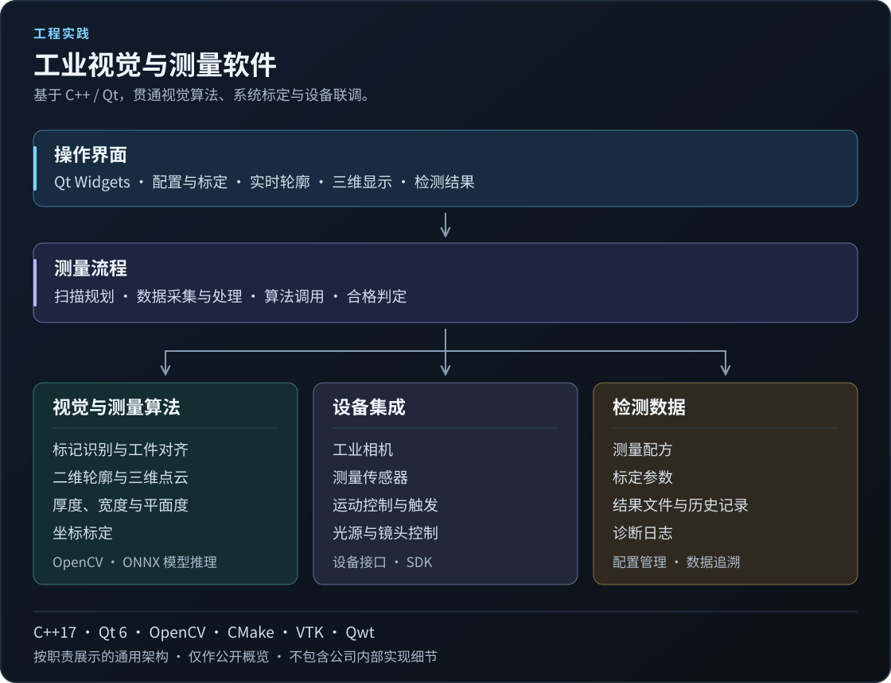

# KangC Xu

[English](README.md) · 简体中文

**算法工程师 · AI 应用与机器视觉 · 苏州**

围绕 AI 视觉与工业测量，开展 YOLO 模型训练、ONNX 推理及 C++ / Qt 应用开发，并将 ChatGPT 和 Codex 融入日常工程开发流程。

## 技术方向

| 方向 | 技术与关注领域 |
| --- | --- |
| 工业软件 | C++17、Qt 6、CMake、模块化桌面应用与设备集成 |
| 机器视觉 | OpenCV、亚像素定位、二维/三维测量与标定 |
| AI 应用 | YOLO、Docker 训练与验证、ONNX、OpenCV DNN 与 ONNX Runtime |
| AI 工具与工作流 | ChatGPT、Codex、Ollama、可复用技能与 MCP 工具集成 |
| 数据分析 | Python、Pandas、NumPy 与数据可视化 |

## AI 应用与开发实践

- **视觉模型训练：** 使用 Docker 训练 YOLO 目标检测模型，通过目录挂载管理数据集和实验输出，开展模型训练与验证，并导出 ONNX 模型用于后续推理集成。
- **推理与软件集成：** 在工业视觉算法中通过 OpenCV DNN 接入 YOLO / ONNX 推理；在个人项目 [OnePiece](https://github.com/KangC-Xu/OnePiece) 中使用 ONNX Runtime 运行 MobileNet 分类示例，配套图像预处理与结果可视化。
- **AI 辅助工程开发：** 主要使用 ChatGPT 和 Codex 辅助代码理解、功能实现、问题排查及中英文文档维护；探索可复用技能、MCP 工具集成和代码知识图谱，为 AI 提供项目上下文，并通过改动审查、编译、针对性测试和界面检查验证结果。
- **本地模型探索：** 使用过 Ollama 在本地运行模型，结合在线 AI 工具开展实践。

## 工程实践

### 工业视觉与测量软件

负责企业内部工业检测系统的算法与应用软件开发，工作涵盖视觉与测量算法、标定、软件框架、操作界面和设备联调。

- **视觉定位与对齐：** 结合几何图像处理与 YOLO / ONNX 推理开发 Mark 识别，开展亚像素线条提取与定位，将图像、CAD/DXF 和设备坐标关联，用于工件对齐和扫描准备。
- **尺寸与形貌测量：** 开发二维轮廓和三维点云处理算法，结合稳健的几何拟合，用于厚度、高度、宽度、间隙、有无及表面平面度检测，并将测量结果接入可配置的合格/不合格判定。
- **系统标定：** 开发相机与运动平台、旋转中心、相机与测量传感器的标定，以及自动化测量中的坐标映射。
- **软件框架：** 基于 C++17 / Qt 6 开发模块化应用，分离界面、业务流程、算法、设备与数据职责；通过统一算法接口及后台采集、处理流程，将算法接入自动化检测。
- **界面与设备联调：** 开发标定、配方配置、实时轮廓、三维可视化和结果分析界面；集成相机、测量传感器、运动控制、光源与镜头控制，配套日志和结果导出。
- **算法库封装：** 将测量与标定算法封装为 C++ DLL，提供 C 接口，使算法库与应用界面、测试程序分离，便于集成和独立验证。
- **算法验证：** 编写合成图像回归用例，检查亚像素定位、噪声、缺边、背景干扰和无效输入等场景；结合诊断叠加图与 CMake / CTest 检查算法改动。

**技术栈：** C++17 · Qt 6 Widgets · OpenCV / DNN · Eigen · CMake / CTest · VTK · Qwt

*以上仅介绍通用工程职责，公司源码、客户信息、内部参数与实现细节不公开。*

## 个人工程实践

### [OnePiece — 算法插件平台](https://github.com/KangC-Xu/OnePiece)

个人编写的 C++ / Qt 学习项目，用于实践如何把算法组织成可交互的桌面工具。

- **插件架构：** Qt 宿主发现 DLL 插件，通过工厂创建算法对象，以统一接口传递输入、参数与结果。
- **算法示例：** OpenCV 阈值、边缘与轮廓检测；基于高度图的点云采样与统计；使用 ONNX Runtime 运行 MobileNet 推理。
- **交互流程：** 通过 Qt Widgets 提供参数表单、图像输入、算法执行和结果预览。

**技术栈：** C++17 · Qt 6 · OpenCV · ONNX Runtime · CMake  
**源码：** [GitHub 仓库](https://github.com/KangC-Xu/OnePiece) · MIT 许可证 · 中英文文档。

其他实验涉及图像增强、几何测量和传感器通信。

## 教育经历

**硕士 · 人工智能**  
英国安格利亚鲁斯金大学（Anglia Ruskin University，ARU）。

**本科 · 电气工程及其自动化**  
江苏理工学院。

## 联系方式

[xukangc.pro@gamil.com](mailto:xukangc.pro@gamil.com)
