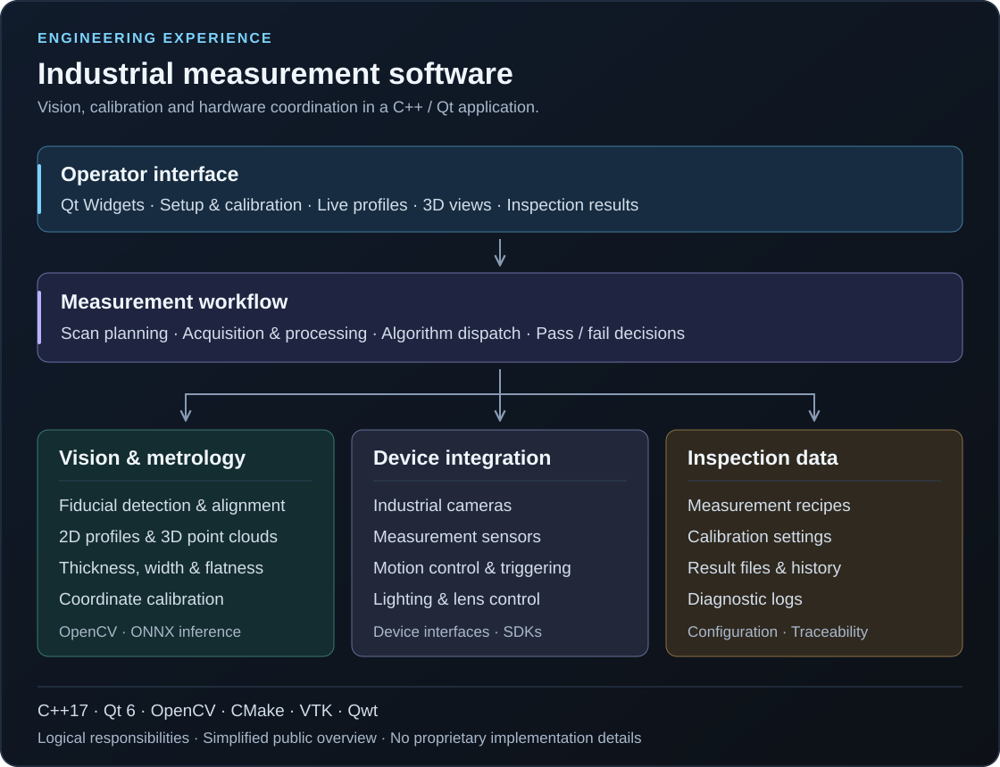

# KangC Xu

[English](README.md) · 简体中文

**算法工程师 · 苏州**

关注机器视觉、工业软件与数据分析，结合 C++ / Qt 工程开发与 Python 分析工具开展实践，同时攻读人工智能硕士。

## 技术方向

| 方向 | 技术与关注领域 |
| --- | --- |
| 工业软件 | C++17、Qt 6、CMake、模块化桌面应用与设备集成 |
| 机器视觉 | OpenCV、二维/三维测量、标定与模型推理 |
| 数据分析 | Python、Pandas、NumPy 与数据可视化 |

## 工程实践

### 工业视觉与测量软件

负责企业内部工业检测系统的算法与应用软件开发，工作涵盖视觉与测量算法、标定、软件框架、操作界面和设备联调。

- **视觉定位与对齐：** 开发基于几何图像处理与 ONNX 模型推理的 Mark 识别和工件对齐，将图像、CAD/DXF 与设备坐标关联，用于定位和扫描准备。
- **尺寸与形貌测量：** 开发并集成二维轮廓和三维点云测量算法，用于厚度、高度、宽度、间隙、有无及表面平面度检测，并将测量结果转化为可配置的合格/不合格判定。
- **系统标定：** 开发相机与运动平台、相机与测量传感器之间的标定流程，统一坐标关系，支撑自动化测量。
- **软件框架：** 基于 C++17 / Qt 6 开发模块化应用，分离界面、业务流程、算法、设备与数据职责；通过统一算法接口及后台采集、处理流程，将算法接入自动化检测。
- **界面与设备联调：** 开发标定、配方配置、实时轮廓、三维可视化和结果分析界面；集成相机、测量传感器、运动控制、光源与镜头控制，配套日志和结果导出。

**技术栈：** C++17 · Qt 6 Widgets · OpenCV · CMake · VTK · Qwt

*以上仅介绍通用工程职责，公司源码、客户信息、内部参数与实现细节不公开。*

## 个人工程实践

### OnePiece — 算法插件平台

个人编写的 C++ / Qt 学习项目，用于实践如何把算法组织成可交互的桌面工具。

- **插件架构：** Qt 宿主发现 DLL 插件，通过工厂创建算法对象，以统一接口传递输入、参数与结果。
- **算法示例：** OpenCV 阈值、边缘与轮廓检测；基于高度图的点云采样与统计；使用 ONNX Runtime 运行 MobileNet 推理。
- **交互流程：** 通过 Qt Widgets 提供参数表单、图像输入、算法执行和结果预览。

**技术栈：** C++17 · Qt 6 · OpenCV · ONNX Runtime · CMake  
**状态：** 个人学习项目，源码暂未发布到 GitHub。

其他实验涉及图像增强、几何测量和传感器通信。

## 教育经历

**人工智能硕士项目 · 在读**  
中国计量大学与英国安格利亚鲁斯金大学（Anglia Ruskin University，ARU）联合举办的硕士项目。

**本科 · 电气工程及其自动化**  
江苏理工学院。

## 联系方式

[xukangc.pro@gamil.com](mailto:xukangc.pro@gamil.com)
